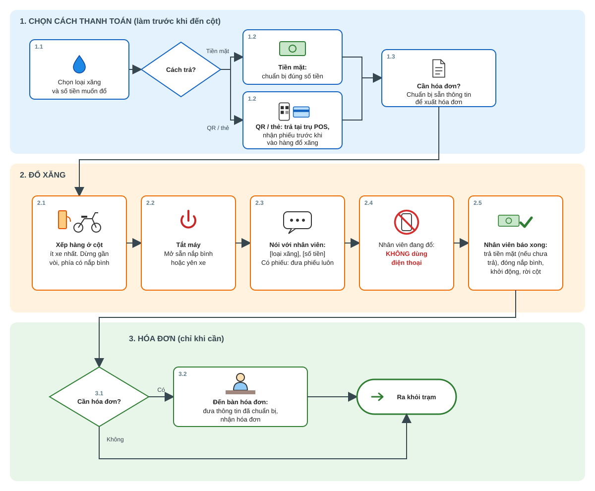

# Q8 — Viết hướng dẫn đổ xăng tại cây xăng nhanh nhất có thể · `[Cr, Q]`

> Bạn hãy viết hướng dẫn (guideline) cho cách đổ xăng ở cây xăng tốn ít thời gian nhất. Tình huống giả lập là xe đang cần thêm xăng. Bạn có thể chọn bất kỳ phương tiện xăng nào mà bạn thích.

**Chúng tôi muốn nghe gì**

Một quy trình. Xác định điểm nghẽn (chọn làn, phương thức thanh toán, thời gian gắn vòi, lấy hóa đơn), song song hóa khi có thể, nêu rõ phương tiện và bố cục cây xăng giả định, và xử lý trường hợp đặc biệt (giờ cao điểm, gần cạn xăng, thẻ hay tiền mặt). Hướng dẫn phải có thể chạy được bởi một người chưa từng đọc nó.

**Tín hiệu tốt:** Bước rõ ràng kèm lý do thứ tự. Đánh đổi rõ rệt (tốc độ vs. an toàn, tốc độ vs. chi phí xăng).
**Tín hiệu yếu:** Checklist chung chung. Không có tư duy tối ưu. Bỏ sót những thắng lợi hiển nhiên (đậu đúng phía có nắp xăng, sẵn sàng phương tiện thanh toán).
---

## Trả lời

### Guideline: đổ xăng nhanh

Đọc khoảng 30 giây. Có 3 giai đoạn: **1. Chọn cách thanh toán, 2. Đổ xăng, 3. Hóa đơn.**

**3 điều bắt buộc, không bỏ qua:** tắt máy; không dùng điện thoại khi nhân viên đang đổ xăng; làm theo hướng dẫn của nhân viên.

**4 loại người dùng và đường đi trong sơ đồ**

| Loại | Cách trả | Hóa đơn | Đường đi |
|---|---|---|---|
| 1 | Tiền mặt | Không | 1.1, 1.2 (tiền mặt), 2.1 đến 2.5, 3.1 (không), ra khỏi trạm |
| 2 | Tiền mặt | Có | 1.1, 1.2 (tiền mặt), 1.3, 2.1 đến 2.5, 3.1 (có), 3.2, ra khỏi trạm |
| 3 | QR, thẻ | Không | 1.1, 1.2 (QR, thẻ), 2.1 đến 2.5 (đưa phiếu ở 2.3), 3.1 (không), ra khỏi trạm |
| 4 | QR, thẻ | Có | 1.1, 1.2 (QR, thẻ), 1.3, 2.1 đến 2.5 (đưa phiếu ở 2.3), 3.1 (có), 3.2, ra khỏi trạm |

#### 1. Chọn cách thanh toán (làm trước khi đến cột)
1. Quyết định loại xăng và số tiền muốn đổ.
2. Chọn một cách trả:
    + **Tiền mặt:** chuẩn bị đúng số tiền (cách chính, ai cũng dùng được).
    + **QR hoặc thẻ:** trả tại trụ POS và nhận phiếu trước khi vào hàng đổ xăng.
3. Nếu cần hóa đơn: chuẩn bị sẵn thông tin để xuất hóa đơn.

#### 2. Đổ xăng
1. Xếp hàng ở cột ít xe nhất. Dừng gần vòi, phía có nắp bình.
2. Tắt máy. Mở sẵn nắp bình hoặc yên xe.
3. Thông báo với nhân viên: "[loại xăng], [số tiền]". Nếu có phiếu, đưa phiếu luôn.
4. Khi nhân viên đang đổ: **không dùng điện thoại**.
5. Nhân viên báo xong: trả tiền mặt (nếu chưa trả), đóng nắp bình, khởi động và rời cột.

#### 3. Hóa đơn (chỉ khi cần)
1. Không cần hóa đơn: ra khỏi trạm. Cần hóa đơn: sang bước 2.
2. Đến bàn hóa đơn, đưa thông tin đã chuẩn bị, nhận hóa đơn.
3. Ra khỏi trạm.

**Gặp tình huống đặc biệt**
- Hàng đông: chọn cột mà xe đầu hàng sắp xong và không có người đang thanh toán rắc rối.
- Gần cạn xăng: chọn cột trống gần nhất.
- Thanh toán lỗi: đổi ngay sang cách khác, không thử lại lâu tại cột.

---

### Phân tích ngắn (dành cho người chấm)

Guideline trên được xây theo PDCA. Phần này chỉ tóm tắt ba điều: ngữ cảnh, giải pháp tối ưu được chọn, và lý do.

**1. Ngữ cảnh**
- Người đọc: người đổ xăng ở mọi tầng lớp, mức quen công nghệ khác nhau. Giả thuyết: không ai đọc tài liệu dài, họ sẽ hỏi nhân viên cho nhanh. Vì vậy guideline ngắn, lời thường, có hình, chia 3 giai đoạn.
- Phương tiện: xe máy.
- Trạm giả định: nhiều cột có nhân viên đổ xăng, một lối vào, một lối ra, mỗi cột có hàng chờ riêng, một trụ POS để trả trước, một bàn hóa đơn riêng có nhân viên phụ trách.
- Mục tiêu: thời gian của mỗi lần đổ ngắn nhất, trong khi an toàn là điều kiện bắt buộc.
- Điểm nghẽn: chờ hàng ở cột, thanh toán tại cột, lấy hóa đơn tại cột.

**2. Giải pháp tối ưu được chọn**
- Quyết định loại xăng, số tiền và cách trả trước khi đến cột.
- Đổ theo số tiền định trước.
- QR hoặc thẻ: trả trước tại trụ POS. Tiền mặt: trả khi nhân viên báo xong.
- Hóa đơn: chuẩn bị thông tin trước, xử lý ở bàn riêng sau khi rời cột.
- Chọn cột ít xe nhất, dừng gần vòi, phía có nắp bình.

**3. Lý do**
- Việc nào làm trước được thì làm trước khi đến cột (quyết định, chuẩn bị tiền, trả trước, thông tin hóa đơn), để xe chiếm cột ngắn nhất.
- Đổ theo số tiền thay vì đổ đầy: không phải chờ đổ đầy và dễ chuẩn bị tiền đúng số. Đánh đổi: phải ghé lại sớm hơn.
- Hóa đơn ở bàn riêng: không chiếm cột, không làm người sau chờ. Đánh đổi: người cần hóa đơn đi thêm một bước.
- An toàn không đánh đổi: tắt máy, không dùng điện thoại khi nhân viên đang đổ. Chi phí xăng giữ nguyên, tôi không đổi trạm vì giá.
- Trụ POS và bàn hóa đơn làm tăng chi phí cho trạm. Lợi ích (giảm tắc nghẽn, tăng hài lòng) là giả thuyết, cần đo trước khi mở rộng; thử ở giờ cao điểm hoặc vài cột trước.

**Kiểm chứng (kế hoạch, chưa thực hiện):** đưa guideline cho một người chưa biết quy trình đổ thử, đạt khi họ làm đúng mà không phải hỏi lại; đo thời gian các bước; sửa bước chậm nhất rồi đo lại.

**Trường hợp đặc biệt**
- Giờ cao điểm (hàng đông): thời gian chờ chiếm phần lớn, nên:
    + Chọn cột theo xe đầu hàng, tránh cột có người đang thanh toán rắc rối. Đánh đổi: tốn vài giây quan sát.
    + Nếu có trạm khác gần đó vắng hơn rõ rệt, đổi trạm. Đánh đổi: tốn thêm quãng đường, chỉ đáng khi hàng chờ dài.
    + Dùng nhánh trả trước nếu trạm có POS di động để thanh toán trong lúc chờ.
    + Nếu chưa cần gấp, hoãn sang giờ vắng. Đánh đổi: phải chấp nhận mức xăng thấp thêm một lúc.
- Gần cạn xăng: bỏ bước chọn cột kỹ, chọn cột trống gần nhất.
- Thanh toán lỗi: chuyển ngay sang cách dự phòng, không thử lại lâu tại cột.

### C — Check
- Thử nghiệm với một người chưa biết quy trình: đưa guideline cho họ đổ thử. Đạt khi họ làm đúng toàn bộ mà không phải hỏi lại. Quan sát chỗ họ dừng, hỏi hoặc làm sai để sửa guideline.
- Thử với vài kiểu người (người lớn tuổi, người ít dùng điện thoại) để kiểm tra giả thuyết về người đọc.
- Đo thời gian từng bước ít nhất 5 lần (chờ hàng, dừng đến bắt đầu đổ, đổ, thanh toán, rời trạm) và so với cách làm trước đây.
- Kiểm tra các giả định ở mục 1 (có nhân viên không, thanh toán thế nào) có đúng với trạm thực tế không.

### A — Act
Dựa trên số đo ở bước Check, thay đổi bước chậm nhất trước (ví dụ đổi cách chọn cột hoặc cách thanh toán). Cập nhật hướng dẫn và đo lại. Lặp lại cho đến khi không còn bước nào cải thiện được đáng kể.

Đề xuất cho trạm (ngoài phạm vi của người đổ xăng): có nhân viên cầm POS đi dọc hàng chờ hoặc trụ thanh toán riêng, để khách trả trước rồi đưa phiếu cho nhân viên đổ. Trụ thanh toán có thể làm hàng chờ mới ở trụ, nên cần đo trước khi triển khai. Bàn hóa đơn riêng có nhân viên cũng cần đo hàng chờ ở bàn đó.

**Lý do quyết định chọn phương án tối ưu cho trạm**
- Chi phí: máy POS di động, nhân viên POS, nhân viên phụ trách bàn hóa đơn.
- Lợi ích (là giả thuyết, cần đo để xác nhận): rút ngắn thời gian xe chiếm cột, giảm tắc nghẽn giờ cao điểm, tăng mức hài lòng, tăng khả năng khách quay lại.
- Chỉ số đo: thời gian xe chiếm cột trung bình, số xe mỗi giờ mỗi cột, độ dài hàng chờ ở POS và ở bàn hóa đơn, tỷ lệ khách quay lại.
- Điều kiện áp dụng: phần lớn khách không cần hóa đơn, và hàng chờ ở POS hoặc bàn hóa đơn không trở thành điểm nghẽn mới.
- Quyết định: thử ở giờ cao điểm hoặc ở vài cột trước. Nếu lợi ích đo được bù lại chi phí thì mở rộng, nếu không thì giữ cách thanh toán hiện tại.

